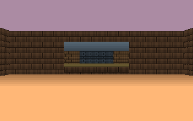

# DoomTeX — Doom in native TeX

Doom, implemented entirely in TeX macros: the renderer, and the game on top
of it. Real WAD geometry, real wall textures, real flats, real sprites and
Doom's own sky; doors, lifts, teleporters, monsters that hunt you, weapons
to answer them with, and a status bar that keeps score. No shell escape, no
LuaTeX, no packages, no external programs. TeX does the arithmetic, the BSP
traversal, the clipping, the texturing, the collision detection and the
monsters' thinking; every pixel is written by macro expansion into the PDF
content stream.

```
pdftex doom.tex
```

That renders sixteen frames of a built-in three-room map into a sixteen-page
PDF, and needs nothing but this repository:



*The built-in map, on procedural textures — every pixel above came out of
`pdftex`, and `gif.py` only repackaged it. No game data is involved.*

With a Doom WAD beside it, it renders — and plays — the real thing:

```
python3 play.py --wad doom2.wad --map MAP01
```

It runs under `pdflatex` too, unmodified and still with no packages, producing
pixel-identical output:

```latex
\documentclass{article}
\begin{document}\input doom.tex\end{document}
```

## What you need

- **pdfTeX** with an eTeX-mode format, which is what TeX Live's `pdftex`
  already is. Nothing else is needed to render or to play.
- **Python 3**, optionally, for the tools: the colour front-end, the GIF
  exporter and the regression harness. All of them are standard library only.
- **A WAD**, optionally. No game data is distributed with this project and
  none may be: `doom2.wad` and `doom.wad` are commercial. Everything in this
  README was measured on `doom2.wad`. The loader reads Doom 1's WADs the
  same way — the harness looks for `doom.wad` or the freely redistributable
  shareware `doom1.wad` and exercises E1M1 if it finds one. A PWAD works if
  it carries its own BSP; only the one file is read, so textures and sprites
  it expects an IWAD to supply fall back to the procedural ones. Put the
  file beside `doom.tex`. Without one you get the
  built-in map on procedural textures, which exercises the whole engine
  apart from the artwork.

**MiKTeX builds `pdftex` from plain TeX**, whose `\newcount` stops at 255
registers — this engine declares several hundred, so every run dies with
`No room for a new \count`. Rebuild the format on eTeX's allocator once:

```
miktex packages install etex
pdftex -ini -jobname=pdftex "*\input pdftexconfig.tex \input etex.src \dump"
```

and put the resulting `pdftex.fmt` where MiKTeX keeps its own (give `etex.src`
by its full path if `kpsewhich` finds a different file of that name). MiKTeX's
`\pdffiledump` is also far slower than TeX Live's on a large file: expect a
commercial IWAD's map to take a minute or several to load where TeX Live
takes a few seconds. Rendering is the same speed on both.

**Big maps need more memory than pdfTeX starts with.** Every texel and every
sprite column is a token list. All thirty-two maps of `doom2.wad` load and
render, and they need between 2.7 million words of main memory (MAP32) and
10.7 million (MAP28); pdfTeX starts with five, which is enough for a dozen
or so of them — MAP01 to MAP05 among them — and stops on the rest with `TeX
capacity exceeded`. `play.py` and `check.py` ask for the extra room
themselves. Running `pdftex` by hand, ask for it yourself — and it has to be
the *top* of memory, where token lists live; `extra_mem_bot` adds room for
boxes and changes nothing:

```
extra_mem_top=30000000 pdftex doom.tex            # TeX Live
pdftex --extra-mem-top=30000000 doom.tex          # MiKTeX
```

(The MiKTeX form is the one this was tested with. The TeX Live form is
Web2C's documented way of setting the same number and is what the tools use
there.)

## Playing

`play.py` is the way to play: single keypresses, colour, and a recording.

| key | |
|---|---|
| `w` `s`, or up and down | walk forward and back |
| `a` `d`, or left and right | turn |
| `z` `c` | step left and right without turning |
| `e`, or space | use: open a door, press a switch |
| `f` | fire |
| `1`–`7` | choose a weapon; `1` and `3` each hold a pair and swap on a second press |
| `q`, or Esc | quit |

The engine is turn-based — one frame per keypress — because TeX has no way to
ask whether a key is waiting. Every frame you see is also a page of
`dtplay.pdf`, so a session is a recording; `gif.py` turns it into an animation.
A level ends when you reach its exit, and the engine says what you left
behind: kills, items and secrets.

Without Python, `pdftex` plays by itself in the terminal, in ASCII, a line of
input per move:

```
pdftex "\def\DTPLAY{1}\def\DTW{76}\def\DTH{60}\def\DTWAD{doom2.wad}\def\DTMAP{MAP01}\input doom.tex"
```

## Modes

Define these *before* inputting `doom.tex`:

| macro | effect |
|---|---|
| `\DTW`, `\DTH` | framebuffer size in pixels (default 200x120) |
| `\DTPIX` | PDF points per pixel (default 3) |
| `\DTFRAMES` | frames to render (default 16) |
| `\DTWAD`, `\DTMAP` | load a real WAD, e.g. `{doom2.wad}` and `{MAP01}` |
| `\DTNOTEX` | keep every surface on the procedural shade tables |
| `\DTNOFLAT` | keep only floors and ceilings procedural, walls still textured |
| `\DTSKY` | sky texture name (default `SKY1`) |
| `\DTX`, `\DTY`, `\DTANG` | override the start position and facing |
| `\DTTURN` | rotate by this many angle units after every step |
| `\DTUSE` | press "use" every frame, so a scripted walk opens doors |
| `\DTFIRE` | hold the trigger down every frame |
| `\DTHOOK` | run once after the engine and map load, before the first frame |
| `\DTPLAY` | interactive: ASCII to the terminal, one frame per keypress |
| `\DTASC` | n: a terminal cell covers n by 2n render pixels (default 1) |
| `\DTPIPE` | hand the frame to a front-end instead of drawing it |

```tex
\def\DTWAD{doom2.wad}\def\DTMAP{MAP01}\input doom.tex  % real Doom map data
\def\DTPLAY{1}\def\DTW{76}\def\DTH{60}\input doom.tex  % playable in the terminal
```

Every feature that changes the world can be switched off, which is how a
regression check written before that feature existed goes on meaning what it
meant — and how you can tell which feature a frame's cost belongs to:

| macro | the world without it |
|---|---|
| `\DTNOMON` | no monsters: nothing hunts you and nothing is solid |
| `\DTNOMIS` | no projectiles: nothing is thrown, and the missile weapons are inert |
| `\DTNOMASK` | middle textures on two-sided lines are not drawn |
| `\DTNOLOCK` | locked doors open for anybody |
| `\DTNOSND` | a gunshot wakes nothing; monsters wake on sight alone |
| `\DTNOWAIT` | no weapon cooldown: one shot a frame |
| `\DTNOZ` | line of sight ignores height |
| `\DTNOSPEC` | sector specials are inert: no strobing lights, no burning floors, no scrolling walls, no secrets |
| `\DTNOPOW` | the timed powers cannot be picked up, and berserk is only a medikit |
| `\DTNOAIM` | a player's missile flies level instead of climbing to its target |
| `\DTNOHOME` | a revenant's missile flies straight |

`\DTUSE` and `\DTFIRE` are read before `\DTHOOK` runs, so they belong in the
preamble rather than in the hook.

Interactive mode needs TeX's normal interaction mode, because `\read16` gets
EOF under `-interaction=nonstopmode`.

### The recording is not the viewport

`\DTW` and `\DTH` are the *render* resolution, in interactive mode exactly as
in batch — so a playable session used to be stuck at whatever size a terminal
could show. `\DTASC{n}` breaks that: a terminal cell becomes the mean of an
n by 2n block of framebuffer pixels (the 2 is the cell's own aspect, which
this used to spend by printing every other row and discarding the rest), and
the render never learns that anything was decimated.

```tex
\def\DTPLAY{1}\def\DTW{304}\def\DTH{240}\def\DTASC{4}\input doom.tex
```

That plays on the same 76x30 terminal a 76x60 render always did, and records
a 304x240 PDF. It is also the *cheap* way to render big interactively: the
filter's per-pixel work is the same at every `n`, but the string appends
collapse with the viewport, so `\DTASC{4}` costs 50 ms a frame on top of the
render where `\DTASC{1}` at the same size costs 207.

## Tools

Six Python files sit beside the engine. All of them are pure standard
library, and none of them is required: the engine plays and records with none
of them present, and nothing in the `.tex` files knows they exist.

| | |
|---|---|
| `play.py` | play it properly: real keys, real colour, demos |
| `gif.py` | turn a recording into an animated GIF |
| `dump.py` | print one frame of a PDF as ASCII, or write it as a PNG |
| `check.py` | the regression harness. **Run it after every change** |
| `mutate.py` | breaks the engine on purpose, one bug at a time, and reports which checks notice |
| `maketest.py` | regenerates `test.wad`, the three-room PWAD the harness loads, from the built-in map |

```
python3 check.py                                  # after every change
python3 play.py --wad doom2.wad --map MAP01       # play it
python3 gif.py doom.pdf out.gif --scale 3         # share it
```

### check.py and mutate.py

`check.py` compiles some three hundred small fixtures and asserts what each
must show — most of them on the built-in map, where three rooms with known
walls make an expected value a number rather than a judgement. If a
commercial or shareware IWAD is beside it, that is exercised too. Everything
it writes goes into `build/`; `python3 check.py --clean` removes it.

`mutate.py` is the harness's own test. Each entry breaks the engine in one
specific way — a strobe that never darkens, a teleporter that works
backwards — and a full run reports which checks noticed. A mutation that
reddens nothing is a check that guards nothing, and several were found that
way. `python3 mutate.py --verify` costs no compiles and confirms every
mutation still finds the line it names; run it after moving any code.

### play.py

A front-end for `\DTPIPE`. The engine hands over the raw framebuffer and this
decides how to show it, which is a decision a TeX macro is in no position to
make — it cannot ask what the terminal can do.

- **Keys without Enter behind them** — the table under *Playing* above —
  arrows as well as letters, space for use, Esc to quit.
- **Colour, at twice the vertical resolution.** One terminal cell carries two
  pixels as an upper half block with the top pixel as foreground and the
  bottom as background. The frame is box-filtered into that grid *in RGB* —
  averaging palette indices would be meaningless, since Doom's palette is
  fourteen unrelated ramps rather than a gradient. The palette comes from the
  engine, so it is right with a WAD and right without one.
- **Or the highest resolution plain text reaches.** `--colors braille` puts
  2×4 dots in every character cell — four times the pixels of a half block,
  eight times one character per pixel — with an ordered dither, no colour,
  and nothing but U+28xx on the wire. `--colors 256` and `--colors mono` are
  there for terminals that want them; a console that will not speak ANSI
  falls back to mono on its own.
- **Demos.** `--record` keeps the key stream and the per-frame state;
  `--replay` plays it back and `--verify` asserts it came out the same. The
  engine is deterministic, so a demo is also a regression test — `check.py`
  runs one, with a control that must diverge.

```
python3 play.py --wad doom2.wad --w 304 --h 240 --record run.dtd
python3 play.py --replay run.dtd
```

### gif.py

The renderer already writes indexed images, and a GIF is an indexed format,
so nothing is resampled and nothing is quantised: an index goes in and the
same index comes out. The palette is read from the PDF, which carries the one
it was drawn with, so there is no `--wad` to get wrong. Frames that repeat are
encoded as a held frame over a transparent index — but only where that
actually helps, measured per frame, because substituting one index for many
breaks up exactly the runs LZW was living on and a turning camera comes out
*bigger* that way.

## How it works

**Fixed point.** Doom's `fixed_t` is 16.16. eTeX evaluates the scaling
operation `a*b/c` with a 64-bit intermediate, which is exactly what `FixedMul`
and `FixedDiv` need:

```tex
\def\fmul#1#2{\number\numexpr(#1)*(#2)/65536\relax}
\def\fdiv#1#2{\number\numexpr(#1)*65536/(#2)\relax}
```

`\dimexpr` looks like the natural home for 16.16, since scaled points *are*
16.16, but dimensions cap at 16383.99998pt and cannot hold Doom's map
coordinates.

**Trigonometry.** 8192 units to a full turn, as in Doom's `FINEANGLES`. The
quarter-turn table is generated at load time by Taylor series and matches a
reference implementation to the unit.

**Rasterising.** `\pdfliteral page` emits a PDF *inline image* per screen
column, with `/F /AHx` so binary pixel data can be written as ordinary hex
text. The palette is registered once as an `/Indexed /DeviceRGB` page resource,
so each column carries one byte per pixel — the same arrangement Doom uses,
where `PLAYPAL` is a 256-entry palette and `COLORMAP` shades by walking along
it. The `page` keyword matters: without it the box origin lands on a fractional
coordinate and the columns leave unpainted seams between them.

**Geometry: Doom's actual structure.** The BSP in the WAD is walked front to
back (`R_RenderBSPNode`), subsector by subsector. Each seg is transformed into
view space, clipped to the near plane, projected, and then narrows a pair of
per-column clip arrays holding the still-open row span. One-sided linedefs
close a column outright; two-sided ones act as portals, drawing an upper
texture where the back ceiling is lower, a lower texture where the back floor
is higher, and leaving the gap between open for whatever the traversal reaches
next. Traversal stops as soon as every column is closed, so geometry behind a
solid wall is never visited.

Because rendering is front to back, a column fills from the outside in: the top
half only ever grows downward and the bottom half only ever grows upward. So
each column is two accumulators, appended and prepended, and nothing ever needs
random access into the middle of a column. That the emitted columns are always
exactly `\DTH` bytes is a good check on the whole clipping scheme.

**Reading a WAD.** `\pdffiledump offset N length M {file}` returns the hex
bytes of any file region, expandably and without shell escape. `wad.tex` parses
the real binary format: the 12-byte header, the lump directory, and a map's
`VERTEXES`, `LINEDEFS`, `SIDEDEFS`, `SECTORS`, `SEGS`, `SSECTORS`, `NODES` and
`THINGS`. `PLAYPAL` is copied out verbatim, because 768 bytes of Doom palette
and a PDF indexed colour space are the same 768 bytes.

The included `test.wad` is a real PWAD with a hand-built BSP. Loading it
produces a render pixel-identical to the built-in level, which is how the
loader is checked. A full commercial IWAD works too: `doom2.wad` MAP01 is
383 vertices, 370 linedefs, 59 sectors, 601 segs and 193 BSP nodes, and loads
in about three seconds.

**Things.** `THINGS` is loaded in full and each thing is placed on the floor of
the sector containing it, found by descending the BSP. After the wall pass each
column is assembled into a single string, and things are composited into it
back to front by an expandable `\dtSplice` that replaces a band in the middle
of an already-built column.

**Sprites.** The artwork is Doom's own. A sprite lump is `width`, `height`,
`leftoffset`, `topoffset`, then a column offset table, then per column a chain
of posts — `topdelta`, `length`, `length` pixel bytes — which is column
oriented and transparency aware, and so lands unusually well on a renderer that
already builds one column at a time. A post's pixels are one `\pdffiledump`
and are never decoded: with a real `PLAYPAL` installed those bytes already
*are* the palette indices the PDF wants. Only the pictures a map actually uses
are read, resolved in one pass over the lumps between `S_START` and `S_END`,
because a full sprite set is 1381 lumps and a map uses a dozen.

Vertical scaling is source driven: walk a post's pixels once and emit each into
however many destination rows it covers, which is exactly what `\Rep` already
produces. That costs O(source height) per screen column rather than O(screen
height), and the column count already falls with distance, so a distant sprite
is a few columns of 56 and a near one is no worse than the wall spans beside
it. Transparency then means one splice per post instead of one band per
column.

Rotations follow Doom: the sprite shown is the one for the angle from the
viewer to the thing less the thing's own facing, biased half a sector so that
rotation 1 is centred on "facing you". Four of the eight are stored as the
mirror of another and share a lump -- `POSSA2A8` is rotation 2 and rotation 8
flipped -- so the picture is read once and the column order reverses at draw
time. A thing that looks the same from every side is stored as rotation 0 and
answers for all eight, which is how every pickup is stored.

The arctangent that needs is built from the sine table at load: walk the
eighth-turn, take each angle's tangent, and fill every slot up to it. The
tangent is monotonic there, so one pass fills the table exactly and no division
by a vanishing cosine ever happens at render time.

Shading goes through `COLORMAP`, Doom's own 34 tables of 256 bytes, keyed by
the two hex characters of the source byte — the form the pixels arrive in, so
nothing is decoded on the way in or out. Walls and flats go through the same
tables once they carry real artwork; only the procedural surfaces of the
built-in map still add 0..13 to a hand-picked ramp base.

**Sprite occlusion.** Doom keeps a drawseg per wall carrying its own clip
arrays, and clips each sprite against every drawseg in front of it. The
equivalent here is to record, per column, every narrowing of the clip arrays
along with the scale at which it happened. Traversal is front to back, so
within a column those records already run near to far: the clip in force at a
sprite's depth is the last record nearer than it, and the lookup is one forward
walk with no sorting and no search. A single depth per column is not enough —
that answers only "is this sprite behind the wall that closed this column", and
a portal never closes one, so a door part way open and a raised platform each
hid nothing at all.

**Doors.** A door is a sector whose ceiling animates, and neither the renderer
nor collision needed to be told about it: both already read the sector's
ceiling every frame, so a descending ceiling closes the view and the headroom
test at the same moment. Linedef specials are read from the WAD, the door
sector is the line's back sector, and it opens to the lowest neighbouring
ceiling less four, as in Doom. Activation is Doom's `P_UseLines` -- the nearest
door line within 64 units whose midpoint is in front of you -- bound to `e` in
interactive mode. Using a door in motion reverses it, though a *held* use key
does not: Doom latches on `usedown`, and without the equivalent a scripted walk
reverses its own door every frame and never gets through it.

A door also has to look like one. Without a real texture on the sidedef there
is no `BIGDOOR2` to sample, so the cue is structural: the wall table bands
horizontally and a second table bands vertically -- ribbed panels, a centre
seam, a frame edge -- and the two are selected by name from the same
`\WallRun`. Which surface is a door falls out of the flag the door scan
already sets, with no new map array: the face is the upper texture of any seg
whose *back* sector is a door, exactly as in Doom, and the track is the door
sector's own one-sided walls, so it keys on the *front* sector instead. The
decision is made once per seg rather than once per column. With a real IWAD
this is now the fallback: MAP01 names `BIGDOOR1` and `DOORTRAK` on those
sidedefs and those are what get drawn.

**Lifts, switches and triggers.** A lift is a door lying down: the same
animating height, the same per-frame tick, the same activation scan, with the
sector's floor where the door machine has its ceiling. Nothing in the renderer
or in collision needed telling here either -- the floor a plane is drawn at,
the height the step-up test measures against, and the surface the camera
settles toward are all the same number, so a player standing on a lift rides
it down.

What that machinery actually needs is a way to read Doom's linedef specials,
and the useful observation is that its hundred-odd numbers are not a list.
Each one is six independent choices: what moves (a ceiling or a floor), which
motion, what fires it (a hand, a switch, or walking over it), whether it fires
more than once, whether it acts on the line's own back sector or on every
sector carrying its *tag*, and whether Doom calls it fast. Split those apart
and one state machine serves every door type, one serves every floor type, and
the special number is just a shorthand for the combination. 51 types are
declared; anything else is inert.

The tag is what makes this more than a bigger door. A manual door acts on the
sector behind it, but a switch acts on every sector carrying its number,
however far away -- one of MAP01's names four at once, and none of them is
anywhere near the switch. Walking over a line is the third route in, and it
reuses the crossing test collision already has: `\dt@segcross` asks whether a
move crossed a seg, which is exactly what a walkover is.

Pressing a switch changes its face from `SW1SOMETHING` to `SW2SOMETHING`.
Vanilla Doom has no lump for that pairing -- the engine holds the list -- but
what the engine holds is the naming convention itself, so the twin can be
recovered from the name. It has to be done when the map loads rather than when
the switch is pressed: only textures a sidedef mentions are ever composited,
and a map naturally mentions only the unpressed one.

**Real wall textures.** A Doom texture is a recipe rather than a picture.
`TEXTURE1` gives a size and a list of patches with offsets, `PNAMES` turns a
patch number into a lump name, and each patch is the same column-and-post
format the sprite reader already handles. All of it is composited once at load
into a flat array of texels, so nothing in the inner loop knows any of it —
only the textures a map's sidedefs actually name (39 of the IWAD's 428 for
MAP01), with their patches resolved in a single pass over a 2928-entry
directory.

A texel is already a palette byte, so drawing one is a nested `\csname`:
scanning the outer `COLORMAP` name expands the inner texel lookup, which
yields the two hex characters that complete the key. The result is two lookups
per pixel, the same as the procedural path, and no conversion at either end.
It also means an undefined texel is a `Missing \endcsname` rather than a wrong
pixel, which is why holes left by a texture's patches are filled at load.

Shading is Doom's own light table: `lightnum` from the sector light's top four
bits, `startmap` of `(15-lightnum)*4`, minus half the scale index, indexed
into `COLORMAP`. Doom's fake contrast comes with it — walls running east-west
are drawn a level darker and north-south a level lighter — and of everything
in this paragraph it is the single biggest contributor to the result looking
like Doom rather than merely being textured correctly.

Textures also have to *line up*. A wall split by the BSP into several segs
continues rather than restarting, because each seg carries its offset along
its linedef; sidedefs carry their own x and y offsets; and Doom's two pegging
flags decide which end of a surface the texture is nailed to. That last one is
not cosmetic: the default for an upper texture is the *back* sector's ceiling,
which is exactly what makes a door's slab travel upward with the ceiling
instead of standing still while the gap opens beneath it.

**Weapon and status bar.** Both are pictures in the same format as a sprite,
composited in screen space with no projection and no depth test, so they reuse
the sprite path with the box set by hand. A weapon patch's offsets *are* its
placement: Doom puts the left edge at `-leftoffset` and the top row at
`-topoffset` in a 320x200 view, which for the pistol puts its 62 rows ending
exactly on the top of the bar.

**Picking things up.** Walking over a stimpack takes it: health goes up, the
number on the bar changes, and the sprite stops being drawn for the rest of
the run. It is the first thing here that changes the map permanently, and the
reason the bar has anything to say.

Doom's rules come with it, and they are not the arithmetic — they are the
return values. A medikit walked over at full health is *refused* and stays on
the floor, while a health bonus is always taken and carries you past 100. A
found weapon brings two clips and comes up in your hands, but only if it is
new; a second shotgun is worth its shells and nothing else. Green armour is
refused if you are already wearing blue. A backpack doubles every maximum
once. Reach is Doom's box test — the sum of the two radii on each axis, plus
a height test, so a stimpack on a ledge cannot be taken from underneath it.
Walking east along MAP01's row of three identical medikits at 50 health takes
two and leaves the third standing, because by then there is no room for it.

**The bar reads the player.** Health, armour and the ammunition of whichever
weapon is in your hands, drawn in Doom's own status bar coordinates from
Doom's own digits, with the percent signs where Doom puts them. Numbers are
right-aligned on the width of the digit zero, for all ten digits — `STTNUM1`
is three pixels narrower than the rest and Doom advances by 14 anyway, which
is what keeps a column of numbers aligned.

The rest of it is there too: the arms panel lighting up the weapons you are
carrying, the key icons, and the eight small numbers down the right — how
much of each ammunition you hold and how much you can. That last column is
the only thing on the bar that ever notices a backpack. The small numbers are
the same drawer as the big ones with a different font, and the pitch is still
the width of that font's own zero, which is the rule rather than a fact about
`STTNUM`.

The face is there too, spread over five levels of damage and glancing left,
ahead and right every 17 frames, on the same clock the sprite animation runs
on — and now that something can hurt you, the rest of it is reachable: the
ouch above twenty points in one hit, the two faces that turn toward whatever
did it, the evil grin at a new weapon, the rampage while the trigger is held,
and `STFDEAD0`.

**Enemies.** A monster is a state machine and the states are the whole of it:
an idle loop until it sees you, a walk cycle while it closes, an attack, a
flinch when hit, and a death animation that ends on the frame it leaves lying
there. Each state names a run of sprite frames, which is the mechanism the
torches already used — the difference is that the sequence belongs to the
*thing* rather than to its type, because two zombiemen in a room are not
doing the same thing.

Sight is the crossing test collision already had, with the two segments the
other way round: does the line from the monster to you cross anything that
stops sight — a one-sided wall, a shut door, a lift at the top. A monster
checks it on a frame change rather than every frame, which is where Doom's
`A_Look` sits too and is the difference between one scan per monster per ten
frames and twenty-nine scans of six hundred segs every frame.

Then it closes, through the same swept collision the player moves with — its
own radius travels in a register the scan reads, so a demon is thirty units
wide and the player is still sixteen — and it attacks. The zombieman, the
shotgun guy, the chaingunner and the SS fire hitscans, `((rand%5)+1)*3` a
shot, exactly as `A_PosAttack` does. The imp, the cacodemon, the two bruisers
and the revenant throw something instead.

**A thrown thing is the first thing here that exists without being on the
map.** Everything else with a position was placed by `THINGS` and outlives
the run; a missile is created by whatever threw it, flies on a velocity, and
is gone. It goes in the same arrays as every other thing, so the projection,
the back-to-front sort, the occlusion and the whole picture reader needed no
changes at all — what it needs beside a thing is a velocity, a state and an
owner. It is walked forward in steps of at most sixteen units, because a
frame here is a forty-unit stride and a plasma bolt covers sixty of them, and
a thing tested only where it lands crosses most of MAP01's walls between two
samples. It is stopped by the opening at the height it arrives at rather than
by a step it cannot climb, which is what lets a fireball fly over a parapet
the imp behind it could not walk up. And it explodes: against geometry,
against a monster, against you. A rocket's blast falls off with distance and
catches whoever fired it.

You shoot back. The aim is `P_LineAttack` reduced to what a hitscan needs —
the nearest live monster whose radius the ray passes inside, then one sight
test to it, so a wall between you stops the shot — and it now runs **once per
pellet**, along an angle Doom's own `(P_Random - P_Random)` scatters, so a
shotgun blast lands on more than one thing. The first shot of a pistol burst
is accurate and the rest are not, which is `P_GunShot`'s `accurate` argument.
Each weapon comes round at its own rate out of Doom's refire tics, so the
chaingun and the BFG stop being the same weapon, and the rocket launcher, the
plasma rifle and the BFG throw what they are supposed to throw.

Monsters flinch on Doom's painchance, die into their corpse, stop being solid
and stop being targets. They fight each other: `P_DamageMobj` points a
victim's target at whatever hurt it, so a fireball that catches a zombieman
in the back starts a brawl — and a missile passes through a thing of its
shooter's own kind, which is what keeps that a thing you provoke rather than
the default state of every map. They hear you, too: a gunshot floods
`P_RecursiveSound` out through the sectors, round corners a sight line cannot
turn, stopping at any line whose opening has closed. And they cannot see over
a parapet, because a sight line now has to pass through each opening at the
height it arrives at.

And you can die: the walking stops and the view sinks to six units above the
floor, which is `P_DeathThink` and is also the only way to see `STFDEAD0`.

**The rest of the sector types.** Crushing ceilings come down to the floor
and eight, go back up, and do it again, hurting whatever is under them; a
`stop` line halts one. Staircases build out from the tagged sector along
Doom's own chain rule — follow a two-sided line to a sector with the same
floor flat, and raise it one step higher than the last — which is why they
accumulate rather than all rising together. That one reuses the moving-floor
machine outright: a stair is a lift told to go up and stay there. Lights are
assignments, including "as bright as the brightest room next door". And the
level exit ends the run and says which frame it happened on, because a level
that finished and one that ran out of frames are different things.

**What a sector is, as opposed to what a line does.** A strobing light, a
pool of nukage and a secret are none of them triggered by anything: a sector
simply *is* one for as long as the level lasts. So those are thinkers,
spawned once at load and ticked once a frame — Doom's five light effects on
their own tic counts, floors that hurt on every thirty-second tic of the
level's clock rather than of the time you spend standing in them, and
secrets that are counted once. Things standing in a strobing room strobe
with it, because a thing is lit by the sector it is in *now*. Walls marked
to scroll slide their texture two and a half units a frame, which is nothing
but the sidedef's own x offset being moved.

**Teleporters, and floors that rise.** A teleporter's tag names a sector,
and what it is looking for there is a *thing* — the destination marker, which
is on the map for no other reason. It takes you only if you walk in through
its front, or stepping off the pad at the far end would send you straight
back; and whatever is standing where you arrive dies of it. Floors that rise
reuse the staircase's machine, and the only new question is *where to*: the
next floor up, the lowest ceiling round about, a fixed distance, or the
height of the shortest texture on the surrounding walls — asked when the line
fires rather than at load, since the answer depends on where the floor has
got to. Some lines are fired by shooting them, which is the aim scan a bullet
already runs asked of a line instead of a monster.

**Powers.** Invulnerability, partial invisibility, the radiation suit and
light amplification are counters that run down, each read in exactly one
place. The two that change the picture do it the way Doom does: the whole
view is drawn through *one* `COLORMAP` table — table 1 for the visor, and
the inverse map, table 32, for invulnerability — settled where a light level
is settled, per wall column and per plane, so no pixel pays for the feature.
Invisibility is Doom's one line in two places: whatever aims at you has a
random swing added to its angle, so hitscans mostly miss and fireballs are
thrown wide. The berserk pack makes the fist hit ten times as hard.

**Missiles that think.** The revenant's missile turns toward its target in
flight, by at most Doom's 16.875 degrees every fourth tic, so it can be
dodged round a corner but not outrun in the open. A player's own missile is
aimed vertically for them — you cannot look up, so the rocket climbs to the
imp on the ledge by itself. And the BFG is forty separate rays fanned from
the *player* across a quarter turn once the ball lands, each stopping at the
first thing it meets: a monster standing behind another is shielded by it.

**Walking around.** The player is located in the map by descending the BSP to a
leaf (`R_PointInSubsector`), and the sector is recovered from the leaf's first
seg the way Doom does it. The eye height eases toward that sector's floor plus
41 units, so stairs read as stairs. Movement goes through a `P_TryMove`
equivalent: the candidate position is tested against every seg — bounding-box
reject, then point-to-segment distance with no square root — and a two-sided
line blocks only when the opening is under 56 units tall or the step up exceeds
24, exactly Doom's rule. A blocked move retries on each axis alone, which
slides the player along walls instead of stopping dead.

Collision tests the *move*, not just where it lands. Checking only the
destination tunnels: a 40-unit step that starts 20 units in front of a wall
ends 20 units behind it, both outside the 16-unit radius, so nothing fires and
the player passes into the void. So the movement segment is also tested for
crossing each wall segment. Since a sealed map cannot be left without crossing
something, that is what keeps the player in the level.

## Measured

pdfTeX 1.40.25, zero errors, no void pixels. Timings vary by more than 2x
between machines; treat these as ratios.

| resolution | relative cost |
|---|---|
| 200x120 (default) | 1.0 |
| 320x200 (Doom's own) | ~1.9 |

Collision adds about 12 ms/frame on a 601-seg map. That was ~4% of a 320x200
frame on the machine it was taken on and is ~8% on the one these were last
run on, which is the whole reason everything else here is a ratio.

**Measure a frame by difference, never by dividing a whole run.** A run is the
load plus N frames, and the load is not small — `check.py`'s benchmark used to
divide and overstated a 320x200 frame by 25% (185 ms for a frame that costs
148) even on the built-in map, which has no WAD to parse. It now compiles
`\DTFRAMES{0}` and `\DTFRAMES{10}`, best of three each and interleaved, and
subtracts.

Interactive mode, same sitting, same method:

| | ms/frame |
|---|---|
| 76x60, engine ASCII | 23 |
| 76x60, `\DTPIPE` | 13 |
| 304x240, `\DTPIPE` — the render alone | 167 |
| 304x240, `\DTASC{4}` → a 76x30 viewport | 217 |
| 304x240, `\DTASC{1}` → a 304x120 viewport | 374 |

Handing the frame to a front-end is *cheaper* than drawing ASCII, so
`play.py` costs the engine nothing. And a coarser viewport is cheaper than a
fine one over the same render, which is why `\DTASC` is what makes playing at
304x240 practical rather than merely readable.

Sprites, measured against the billboard version in the same window -- machine
speed drifted by 1.6x between sittings, so only same-window numbers mean
anything:

| 320x200 MAP01 | relative |
|---|---|
| geometry only, no things | 0.87 |
| geometry + billboards | 1.00 |
| geometry + real sprites, 8 rotations | 1.03 |

`COLORMAP` and 26 pictures add about 0.2 s to the load.

Wall textures, measured against the pre-texture tree in the same window, best
of three:

| 320x200 MAP01 | relative |
|---|---|
| geometry only, procedural walls | 1.00 |
| geometry only, composited `TEXTURE1` walls | 1.13 |
| whole frame, sprites and HUD in shot | ~1.00 |

The render cost is near enough unchanged because both wall paths are two
`\csname` lookups per pixel: the procedural one adds a shade to a ramp base
and converts with `\hx`, and the textured one reads a palette byte that is
already two hex characters and shades it through `COLORMAP`.

Flats and the sky, measured the same way:

| 320x200 MAP01 | relative |
|---|---|
| geometry only, procedural planes | 1.00 |
| geometry only, real flats and sky | 1.62 |
| whole frame, sprites and HUD in shot | 1.26 |

A plane pixel costs more than a wall pixel because it needs its world
position and a wall pixel does not. Along a single column, though, that
position is just a scalar multiple of the depth — `lateral/depth` is fixed
for the column — so the direction terms are per-column constants and each
pixel is one multiply-add per axis. Depth itself factors into a per-row
table, so no plane pixel divides.

### The string pool

The interesting constraint in this project turned out not to be time or
memory but **`max_strings`**: 496,994 under `pdftex`, 476,106 under
`pdflatex`, and every `\csname` costs one. At one control sequence per texel,
MAP01's 39 wall textures alone were 419,768 strings — 92% of the budget — and
adding flats died with `TeX capacity exceeded [number of strings]` with no
other symptom.

Both texel arrays are therefore packed **eight texels to a control sequence**,
picked apart by an eight-parameter macro. Textures pack along `u`, which is
fixed for a whole column span, so the group and which-of-eight are settled
once per column and the inner loop pays a macro call and no arithmetic. That
takes the whole load from 477k strings to **111k** — and it is *faster*, 0.84
on the geometry pass, because 111k strings hash better than 477k.

Loading MAP01 now composites 40 textures from 55 patches (+0.7 s, 53k texel
macros) and reads 30 flats (+0.4 s, 15k texel macros).

## TeX traps worth knowing

Most of these fail silently.

- **A line ending after a control word produces no space token.** TeX is
  skipping blanks, so `\rb=...\fi` at end of line does not terminate the number
  scan — it runs on into the next line and expands whatever it finds. Here it
  expanded `\dtWhile` and ran the column loop *from inside the assignment*,
  drawing 16 columns and then stopping. Terminate with `\relax`.
- **Instrumentation hides it.** Adding any register assignment before the loop
  gave the runaway scan something unexpandable to stop at, so the bug vanished
  whenever it was measured.
- **`\numexpr` division rounds, it does not truncate.** All modular arithmetic
  must go through `\divide`.
- **`\dtU32` is not a control sequence.** Digits are not letters, so it parses
  as `\dtU` followed by `32` — and `\dtU16` and `\dtU32` silently define the
  same macro with conflicting parameter texts.
- **A macro grabs its arguments before a later `\expandafter` fires.**
  `\expandafter\dtColumn\expandafter{\the\cx}\expandafter{\dt@col}` passes
  `\expandafter` as the second argument; the pixel data then gets *typeset*
  rather than embedded, and every inline image comes out empty. Both
  `\pdfliteral` and `\xdef` expand their arguments, so the chain is unnecessary.
- **Register aliasing.** `\tmpj` was both the frame counter and a seg's vertex
  index, so the frame loop never advanced and the camera walked to infinity.
- **Projection handedness.** Lateral is to the viewer's left, so
  `x = SCRW/2 - l*PPLANE/d`. Getting it backwards only mirrors a z-buffered
  image, but it inverts the `x1 < x2` test that culls back-facing segs.
- **Plain TeX's `\loop` cannot nest**; every `\loop` redefines the same `\body`.
- **Every line end inside an `\edef` is a space token.** Two stray `\fi` line
  endings tripled the width of every ASCII row.
- **`\ifx` compares catcodes.** `\pdffiledump` yields catcode-12 characters
  while a hex table built from source produces catcode-11 letters for A-F. Use
  `\pdfstrcmp`.
- **`\or@` is a control word** when `@` has letter catcode.
- **The page builder must be neutralised.** This uses TeX as a program, so any
  stray material reaching the main vertical list emits blank pages between
  frames.
- **A real `PLAYPAL` is not sixteen ramps of sixteen.** Doom's palette has rows
  holding two eight-entry ramps and rows mixing unrelated colours, so a surface
  shaded by adding 0..13 to the wrong base inverts in brightness halfway down.
  Invisible on a synthetic palette; only a real IWAD shows it.
- **Point-in-map always succeeds.** Descending the BSP returns a leaf for any
  coordinate, inside the map or not, so "which sector am I in" cannot be used
  to detect that the player has escaped. Void pixels in the render can.
- **Scale is `PPLANE*65536/depth`.** A 16.16 height difference becomes pixels
  with two divisions by 65536; a plain map length needs one. Getting that wrong
  is a silent factor of 65536 -- it put every sprite under the one-pixel clamp
  regardless of distance, which reads as "sprites are thin" rather than as an
  arithmetic error.
- **pdfTeX hard-wraps terminal output at 79 characters**, mid-token. Anything
  parsing a `\message` out of the log must delete the newlines first, or it
  silently drops whichever lines happened to straddle a wrap.
- **`\ifnum` pushes back the token that ended its operand.** Terminating the
  bound with `\relax` -- `\ifnum\a>\b\relax \b\else...` -- does stop the
  number scan, but the `\relax` comes back at the head of the branch, so the
  branch value is never read and the assignment gets nothing. A count register
  needs no terminator at all, which is why the resampler keeps its constants in
  registers rather than macros.
- **A space after a control word is not a token either.** Same cause as the
  line-ending trap above: `\ifnum\x<\lo \lo\else` reads *both* macros as one
  number and the branch silently disappears into it.
- **A macro that assigns into an argument is not a macro that returns a
  value.** `\dtIsqrt#1#2` sets `#1`; written as `\dtDK=\dtIsqrt{...}` the
  register assignment consumes the `\isq@n` at the head of the body as its
  number, the assignment ends, and the *rest of the body* is left as text. The
  bare `=` starts horizontal mode and the error names whatever primitive
  happens to come next -- here, "You can't use `\numexpr' in horizontal mode".
- **An included file can change catcodes under you.** `wad.tex` and `play.tex`
  both end with `\catcode`\@=12`, so everything below `\input wad.tex` parses
  `\dt@foo` as `\dt` followed by `@foo`. It only breaks when a WAD is
  actually loaded, which is the worst kind of conditional trap; restore the
  catcode after the input rather than avoiding `@` below it.
- **An error prompt eats a line of stdin.** In TeX's normal interaction mode --
  which interactive mode requires -- an error asks the terminal what to do, and
  a fixture feeding keystrokes will answer it with the next key. If that key is
  `q`, TeX switches to batchmode and every later error goes to the log alone. A
  harness that greps *stdout* for errors then reports a clean run.

## What this is and is not

This walks the BSP from a real WAD, renders one- and two-sided linedefs with
their actual `TEXTURE1` wall textures composited from `PNAMES` patches, shades
them through Doom's own `COLORMAP` by sector light and distance, fills floors
and ceilings per sector, locates the player in the map, follows floor heights,
collides with and slides along the geometry, opens doors, rides lifts, presses
switches, trips walkover triggers, and composites the
map's things into the scene as real sprite artwork with correct per-column
occlusion and frame animation, and lets you pick those things up and watch the
status bar say so. Floors and ceilings carry the map's own flats, shaded by
distance on Doom's `zlight` table, and `F_SKY1` ceilings show the sky. You can
walk around MAP01, collect the shotgun, and it looks like MAP01.

Monsters wake when they see you or hear you, walk at you, shoot, throw
fireballs, flinch, turn on each other, die and lie where they fell; you shoot
back with all of Doom's weapons at each one's own rate, and they can kill
you.

Crushers crush, stairs build, floors rise, lifts run for ever until a line
stops them, lights strobe and glow, nukage burns, teleporters teleport,
locked doors want their keys, some switches want shooting, MAP01's railings
show the room through them, and the exit ends the level and counts up what
you found.

Sixteen of Doom II's monsters walk, see, hear, fight you and fight each
other; all nine weapons fire at their own rate; and of the linedef specials
the thirty-two levels of `doom2.wad` actually use, all but three kinds are
implemented — a door that shuts itself after thirty seconds, and the two
teleporters only a monster can use.

**It is still not Doom**, and the list of what is missing is short enough to
give in full:

- **Real time.** One frame per keypress, and a frame is a whole stride —
  forty units, about two and a half of Doom's tics. Everything that has a
  rate is scaled to that, so the *ratios* are Doom's and the feel is a
  turn-based game.
- **Two monsters and the bosses.** The arch-vile, which raises the dead, and
  the pain elemental, which spawns lost souls, need mechanisms nothing else
  uses; they stand where the map put them as scenery. So do Commander Keen
  and the final boss. The mancubus throws one fireball where Doom's throws
  six.
- **A handful of specials.** The timed doors, the "donut", ceilings that
  lower and crush once, monster-only teleporters (nothing but the player
  triggers a line here), and the tag-666 effects that end MAP07 and the
  episode bosses. A floor that rises "and changes" takes its new flat but
  not always its new special.
- **No automap**, so the computer map is left on the floor; **no sound**,
  though monsters hear your gun; **no saved games**, and no carrying your
  weapons from one level into the next — a level is a run of `pdftex`.
- **Vertical aim is automatic only**, as in Doom, but monsters and missiles
  collide as cylinders of infinite height.

Whatever is added next, note that the string pool is the resource to watch:
anything wanting a per-texel array has to pack it eight to a control sequence
the way the textures and flats do.

Running actual Doom would be a different project: implement a CPU in TeX
macros, with memory as a `\csname` hash table, and run a compiled binary. TeX
manages a few million macro operations per second and an emulated instruction
costs tens of those, so expect minutes per frame — a filmstrip, not a game.

## What is in the repository

| | |
|---|---|
| `doom.tex` | the engine: arithmetic, renderer, movement, things, the status bar, the sector machinery, monsters, missiles, weapons, and the main loop |
| `wad.tex` | the WAD loader; fills exactly the arrays the built-in map does |
| `play.tex` | interactive mode: the terminal viewport, the frame pipe, the key loop |
| `test.wad` | a real PWAD of the built-in map, with a hand-built BSP — the harness loads it and requires the same picture |
| `play.py` `gif.py` `dump.py` | the front-end and the two exporters |
| `check.py` `mutate.py` `maketest.py` | the regression harness, its mutation table, and the generator for `test.wad` |
| `INTERNALS.md` | the engineering notes: the data model, every pipeline, the TeX traps in full, what each milestone cost and what each mutation found |
| `LICENSE` | the GNU General Public License, version 2 |

`build/`, which `check.py` creates, and the `.tex`, `.log` and `.pdf` that a
run of `play.py` leaves beside it are outputs and are ignored by git.

## Licence

DoomTeX is free software: you can redistribute it and/or modify it under the
terms of the GNU General Public License as published by the Free Software
Foundation, either version 2 of the License or (at your option) any later
version. It is distributed in the hope that it will be useful, but WITHOUT
ANY WARRANTY; without even the implied warranty of MERCHANTABILITY or FITNESS
FOR A PARTICULAR PURPOSE. The full text is in [`LICENSE`](LICENSE), and every
source file carries the identifier `GPL-2.0-or-later`.

That is the licence the Doom source itself was released under, which is the
reason for the choice: this engine was written with that source open beside
it.

## Doom

Doom and Doom II are id Software's. This repository contains none of their
data: the engine reads its artwork and its maps out of a WAD that you supply.
It is a reimplementation in another language rather than a translation, but
it follows the structure of the released Doom source closely — the comments
name the functions each macro corresponds to — and the numbers in its tables,
a zombieman's twenty hit points or a rocket's speed, are Doom's own, because
a port that changed them would be a different game.
